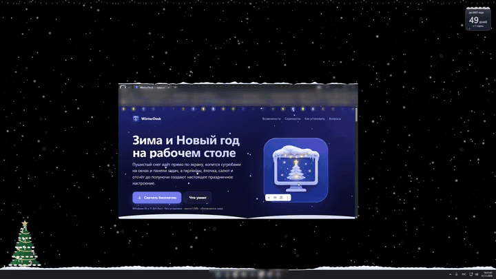
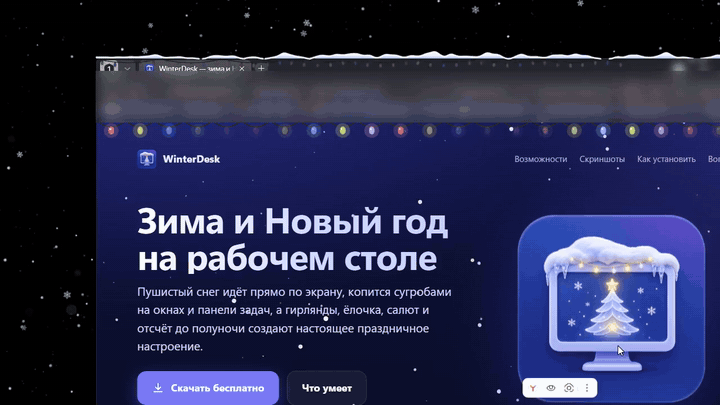
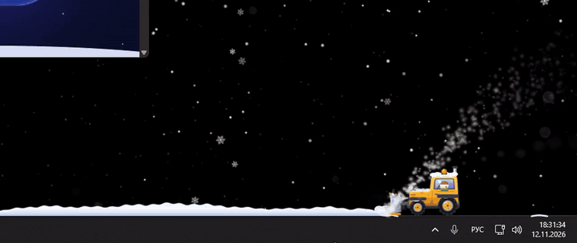
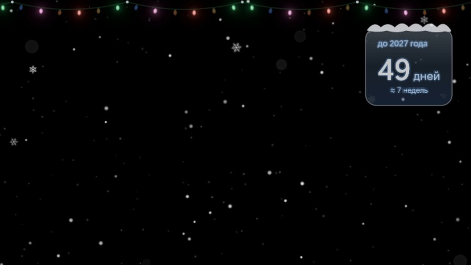
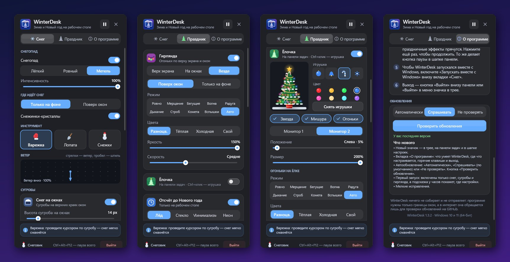

  

  

  
  
  

<h1 align="center">WinterDesk для Windows</h1>

  <b>Программа для Windows 10 и 11: пушистый снег прямо на рабочем столе.</b> 
  Сугробы на окнах и панели задач, гирлянды, ёлочка, салют и отсчёт до Нового года. 
  Бесплатно · без установки · без рекламы · обновляется сама.

---

## ✨ Что умеет

| | |
|---|---|
| ❄️ **Живой снегопад** | Объёмные хлопья на всех мониторах — крупные и размытые вблизи, мелкие вдали. Тихий снежок, ровный снег или метель, ветер в любую сторону. |
| 🏔️ **Сугробы** | Снег копится на верхних краях окон и на панели задач. Подвиньте окно — сугроб поедет вместе с ним, потрясите — осыплется. |
| ✨ **Гирлянды** | По верху экрана и на окнах: десяток режимов огоньков, свои цвета и яркость. |
| 🎄 **Ёлочка** | Нарядная ёлка на панели задач с огоньками, мишурой и звездой. Игрушки можно развесить самому. |
| ⏳ **Отсчёт до Нового года** | Красивый таймер на рабочем столе, а в полночь — большой финал «С Новым годом!». |
| 🎆 **Салют и Дед Мороз** | Фейерверки и сани с оленями, пролетающие по небу. |
| 🧤 **Варежка, лопата, снежки** | Смахивайте снег курсором, катайте снежки с зажатым <kbd>Ctrl</kbd> — из трёх шаров получится снеговик ⛄. |
| 🚜 **Трактор** | Расчищает панель задач по кнопке или сам — по расписанию или когда сугроб вырастет. |
| 🎮 **Не мешает** | Клики проходят сквозь снег, в играх и видео на весь экран — автопауза. <kbd>Ctrl</kbd>+<kbd>Alt</kbd>+<kbd>F12</kbd> — пауза всего. |

## 📸 Как это выглядит

  

  

  

  

  

## 📥 Как установить

1. Скачайте **[WinterDesk-win64.zip](https://github.com/NikoliniOFF/WinterDesk/releases/latest/download/WinterDesk-win64.zip)** (или выберите файл на странице [последней версии](https://github.com/NikoliniOFF/WinterDesk/releases/latest)).
2. Распакуйте архив в любую папку, например `Документы\WinterDesk`.
3. Запустите **WinterDesk.exe** — снег пойдёт сразу.
4. Если Windows покажет синее окно *«Система Windows защитила ваш компьютер»*, нажмите **«Подробнее» → «Выполнить в любом случае»** (подробнее — в разделе «Вопросы»).

> Устанавливать ничего не нужно: WinterDesk — одна маленькая программа. Чтобы удалить, нажмите «Выйти» и удалите папку.

## ⚙️ Где настройки

Все настройки — в одной панели. Она открывается **щелчком по значку WinterDesk в трее** — справа внизу, у часов.

- Не видно значка? Нажмите стрелку <kbd>^</kbd> рядом с часами — он может прятаться там. Перетащите его мышью на панель задач, чтобы он всегда был на виду.
- **Правый клик** по значку — быстрое меню: пауза, очистить снег, вызвать трактор, выход.
- Вкладка **«Снег»** — снегопад, сугробы, инструменты, ветер, трактор и *«Запускать вместе с Windows»*.
- Вкладка **«Праздник»** — гирлянда, ёлочка, отсчёт, салют, Дед Мороз, сосульки, следы курсора.
- Вкладка **«О программе»** — подсказки, версия и обновления.

При первом запуске включены только снег, сугробы и гирлянда — остальное включите по вкусу.

## 🔄 Как обновлять

WinterDesk сам проверяет новые версии на этой странице (через минуту после запуска и затем раз в 12 часов). Во вкладке **«О программе» → «Обновления»** можно выбрать:

- **Автоматически** — новая версия скачается и установится сама;
- **Спрашивать** *(по умолчанию)* — появится подсказка у часов и кнопка «Обновить»;
- **Не проверять** — только вручную, кнопкой «Проверить обновления».

Настройки при обновлении сохраняются. Каждый выпуск проверяется по размеру и контрольной сумме SHA-256.

## ❓ Вопросы

<b>Windows пишет «Система Windows защитила ваш компьютер»</b>

Это фильтр SmartScreen: программа новая и пока не подписана платным сертификатом. Нажмите **«Подробнее»**, затем **«Выполнить в любом случае»**. Скачивайте WinterDesk только со [страницы выпусков](https://github.com/NikoliniOFF/WinterDesk/releases) — рядом с каждым архивом лежит файл `.sha256` с контрольной суммой.

<b>Как поставить на паузу или выключить?</b>

<kbd>Ctrl</kbd>+<kbd>Alt</kbd>+<kbd>F12</kbd> — пауза всего (ещё раз — продолжить). Выйти: кнопка «Выйти» внизу панели или «Выйти» в меню значка.

<b>Не будет ли тормозить компьютер или игры?</b>

Нет. WinterDesk рисует через видеокарту, работает с пониженным приоритетом и сам встаёт на паузу, когда игра или видео развёрнуты на весь экран.

<b>Как запускать вместе с Windows?</b>

Включите «Запускать вместе с Windows» внизу вкладки «Снег».

<b>Программа что-нибудь собирает или отправляет?</b>

Нет. WinterDesk нужны только границы окон (содержимое окон он не читает). В интернет он обращается лишь к GitHub, чтобы проверить обновления, — это можно выключить.

## 💻 Системные требования

- Windows 10 или Windows 11, **64-бит**
- Видеокарта с поддержкой DirectX 11 (есть практически в любом компьютере)
- Около 1 МБ на диске

---

  <a href="https://nikolinioff.github.io/WinterDesk/">Сайт</a> ·
  <a href="https://github.com/NikoliniOFF/WinterDesk/releases">Все версии</a> 
  С наступающим! ❄️🎄

