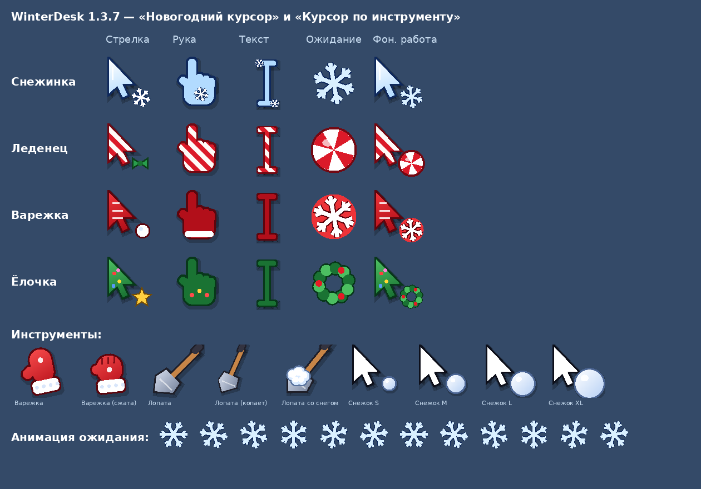

## ❄️ WinterDesk для Windows 1.3.7

**Скачать:** `WinterDesk-1.3.7-win64.zip` ниже (или постоянная ссылка `WinterDesk-win64.zip`). Распакуйте и запустите `WinterDesk.exe`.

### Что нового
- 🎅 Новогодний курсор: четыре набора — Снежинка, Леденец, Варежка и Ёлочка — для стрелки, руки, текста и ожидания, а значок ожидания крутится. Размер подстраивается под масштаб экрана. На паузе, в играх и при выходе стандартные курсоры возвращаются сами, а кнопка «Вернуть стандартные курсоры» есть во вкладках «Праздник» и «Общие». Включается во вкладке «Праздник» (по умолчанию выключен).
- 🧤 Курсор по инструменту: над снегом курсор становится варежкой (сжимается, когда гребёт снег), лопатой (наклоняется, когда копает, а на лопате видно снег) или стрелкой со снежком, который растёт, пока вы его катаете. Переключатель «Курсор по инструменту» во вкладке «Снег».
- 🖱️ Из инструмента легко выйти: кнопка «Обычная мышь» рядом с варежкой, лопатой и снежками, клавиша Esc или правый клик. При первом выборе инструмента WinterDesk один раз подскажет, как вернуть обычную мышь.
- 🎮 Игры и видео на весь экран: во вкладке «Общие» появились настройки «Во время игры» и «Видео на весь экран» — пауза на всех мониторах (по умолчанию, как Ctrl+Alt+F12), только на этом мониторе или не останавливать. Когда игра или видео закрываются, снег продолжается сам, а ручная пауза Ctrl+Alt+F12 остаётся вашей.
- ⛄ Катящийся снежок крутится ровно вокруг своего центра и не проваливается в сугроб и панель задач — и не подпрыгивает над ними. Тень и блик больше не вращаются вместе со снежком.
- 🧱 Края экрана: снежок, брошенный в край экрана, разбивается о него, как об окно, а катящийся мягко отскакивает и остаётся на экране. Между мониторами снежки пролетают свободно.
- 🪟 Крепости, снеговики, снежки и трактор на панели задач прячутся за окнами вместе с сугробом (например, за оверлеем NVIDIA), а не рисуются поверх них.
- 🏃 Сугроб и снеговик на окне двигаются вместе с окном без отставания, когда вы его тащите.
- ❄️ Снег на курсоре: шапка из неровных комочков налипает на верхний край стрелки постепенно, держится ровно на курсоре и осыпается кусками, как только сдвинете мышь. Подстраивается под форму новогоднего курсора и инструментов. Новый значок у этой настройки.
- 🎨 Свой цвет снега: радужная полоса оттенка с ползунком, полосы насыщенности и яркости с живым градиентом и превью — сразу видно, каким будет снег.

### Если Windows предупреждает
SmartScreen может показать «Система Windows защитила ваш компьютер» — нажмите «Подробнее» → «Выполнить в любом случае».

**Требования:** Windows 10 или 11, 64-бит.
